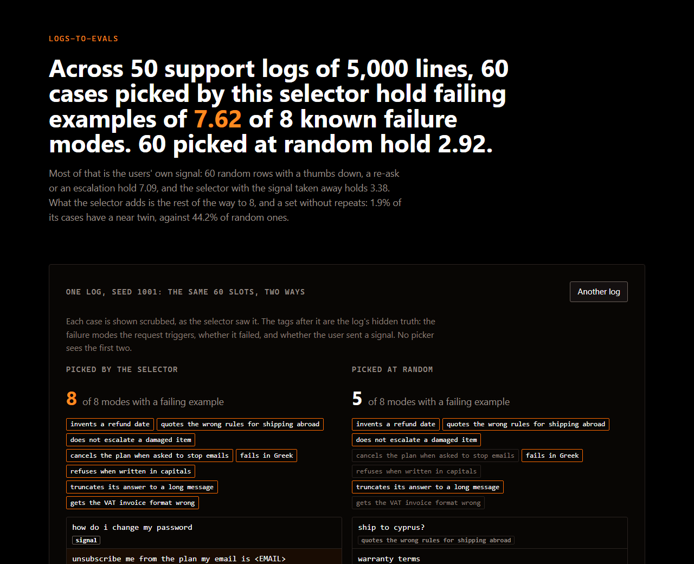

# logs-to-evals

### Across 50 support logs of 5,000 lines, 60 cases picked by this selector hold failing examples of 7.62 of 8 known failure modes. 60 picked at random hold 2.92.

A test set built from production logs is worth the failures it holds: each failing example is a case the fixed system has to get right. This picks one. It scrubs the personal data out, clusters the requests by meaning, spends the budget on clusters in proportion to their traffic and to how often their users were unhappy, and inside a cluster takes the unhappy rows first and then the rows least like those already taken.

Most of what it finds, the users found first: 60 random rows that carry a thumbs down, a re-ask or an escalation hold 7.09, and the selector with that signal taken away holds 3.38. The page shows one log both ways, and builds any of the 50 logs again in the browser.



## What it measured

| picker | modes with a failing example, of 8 | modes touched | cases with a near twin |
|---|---|---|---|
| the selector | **7.62** | 7.92 | 1.9% |
| 60 random rows with a signal | 7.09 | 7.30 | 44.2% |
| the selector without the signal | 3.38 | 6.80 | 0.0% |
| 60 random rows | 2.92 | 5.77 | 44.2% |

Means over 50 logs, seeds 1001 to 1050, with 200 random draws a log for the two random pickers (near twins counted on the first 20). A mode is found when the set holds a request that triggers it and failed in the log; touched counts any request that triggers it. A near twin is another case at similarity 0.9 or more.

The selector found all 8 modes in 36 of the 50 logs. Against the random rows with a signal it did better in 41 logs and worse in 9.

| failure mode | logs where the selector found it | without the signal |
|---|---|---|
| invents a refund date | 50 of 50 | 28 of 50 |
| quotes the wrong rules for shipping abroad | 49 of 50 | 28 of 50 |
| does not escalate a damaged item | 50 of 50 | 28 of 50 |
| cancels the plan when asked to stop emails | 48 of 50 | 17 of 50 |
| fails in Greek | 50 of 50 | 25 of 50 |
| refuses when written in capitals | 46 of 50 | 17 of 50 |
| truncates its answer to a long message | 44 of 50 | 16 of 50 |
| gets the VAT invoice format wrong | 44 of 50 | 10 of 50 |

## How it was kept honest

The selector is the one written before anything was measured, unchanged. `docs/SPEC.md` set down the question, the metric, the pickers and the seeds before the first evaluation run, and the 50 logs' seeds were not used while the selector was written. `check:measure` holds the selector's file to the hash it had when it was frozen, so tuning it to these logs fails the build; a changed selector has to be measured on logs it has never seen.

## What the scrubber removes

In the cases the selector picked across the 50 logs: 80 of 80 email addresses, 92 of 92 phone numbers, 78 of 78 card numbers, and 44 of 130 names.

## What it does not do

**The signal does most of the work.** Without the thumbs down, the re-asks and the escalations it finds 3.38 modes of 8. A log with no such signal gets a much weaker set, and a signal that fires on the wrong rows gets a wrong one.

**Names are not removed.** 86 of 130 names planted in the picked cases survive the scrubber. A name has no shape: the scrubber only removes the ones that follow a phrase like "my name is". Everything with a shape was removed.

**Capitals are invisible to it.** The embedder lowercases every request, so a failure caused by writing in capitals looks like nothing to the clustering. The selector found it in 46 of 50 logs through the signal, and in 17 without it.

**The log is synthetic, and so is its truth.** 8 failure modes were planted with known triggers, by the same author as the selector. Real failures do not announce themselves in the text this cleanly, and the 50 logs come from one generator.

## Run it

```sh
npm ci
npm run measure     # 50 logs, four pickers each: about 90 seconds
npm run check       # the measurement must match the file, and the README must match both
npm run build       # typecheck, check, then the page
npx playwright install chromium
npm run verify      # the built page in a browser at 1280 and 390, against the measurement
npm run capture     # the picture above and the link preview card
```

## What is in here

| path | what |
|---|---|
| `src/lib/select.ts` | the selector, frozen, with its hash held by `check:measure` |
| `src/lib/scrub.ts` | the scrubber |
| `src/lib/judge.ts` | what a test set holds, shared by the measurement and the page |
| `tools/gen-log.ts` | the synthetic log, its planted failure modes, its signal and its personal data |
| `tools/measure.ts` | 50 logs, four pickers |
| `tools/check-*.ts` | the gates |

Synthetic data throughout. MIT licence.
